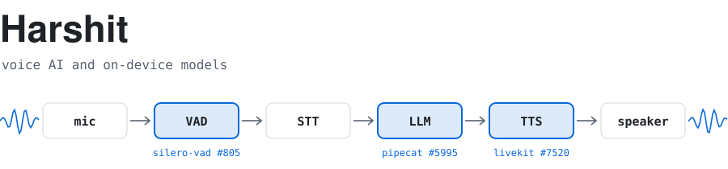

<picture>
  <source media="(prefers-color-scheme: dark)" srcset="assets/header-dark.svg">
  
</picture>

### Merged pull requests

| Project | PR | What it fixed |
|---|---|---|
| pipecat | [#5995](https://github.com/pipecat-ai/pipecat/pull/5995) | Non-ASCII text came back escaped in async tool results |
| livekit/agents | [#7520](https://github.com/livekit/agents/pull/7520) | TTS held text forever behind a `*` or `_` that never closed |
| livekit/agents | [#7565](https://github.com/livekit/agents/pull/7565) | Same escaping bug in MCP results |
| livekit/python-sdks | [#802](https://github.com/livekit/python-sdks/pull/802) | Event handlers ran out of registration order |
| silero-vad | [#805](https://github.com/snakers4/silero-vad/pull/805) | Negative threshold could drop below 0.01 |
| nlohmann/json | [#5461](https://github.com/nlohmann/json/pull/5461) | `diff()` was quadratic when an array shrinks |
| duckdb | [#25752](https://github.com/duckdb/duckdb/pull/25752) | Parquet v2 value count was wrong for nulls in a full list |
| fmt | [#4910](https://github.com/fmtlib/fmt/pull/4910) | Ranges and tuples ignored fill, alignment and width |

Also merged in 9 other projects

[cpp-httplib](https://github.com/yhirose/cpp-httplib/pull/2577) · [growthbook](https://github.com/growthbook/growthbook/pull/6827) · [tailcat](https://github.com/tailscale/tailcat/pull/121) · [openpanel](https://github.com/Openpanel-dev/openpanel/pull/476) · [Serial-Studio](https://github.com/Serial-Studio/Serial-Studio/pull/323) · [openzl](https://github.com/facebook/openzl/pull/932) · [audio.cpp](https://github.com/0xShug0/audio.cpp/pull/339) · [needle](https://github.com/cactus-compute/cactus/pull/54) · [diagram-design](https://github.com/cathrynlavery/diagram-design/pull/182)

### My projects

| | |
|---|---|
| [tinycue](https://github.com/avionicharshit-byte/tinycue) | YAML of example commands to a 250 KB model. 5 ms on an ESP32, English and Hinglish. |
| [openzl-agent](https://github.com/avionicharshit-byte/openzl-agent) | Trains an OpenZL compressor for your data. 50% smaller than zstd -3 on a CSV. |
| [docpilot](https://github.com/avionicharshit-byte/docpilot) | Document agent prototype for loan officers. [Demo](https://superleap-docpilot.netlify.app/) |

avionicharshit@gmail.com · [YouTube](https://www.youtube.com/@AvionicHarshit)
